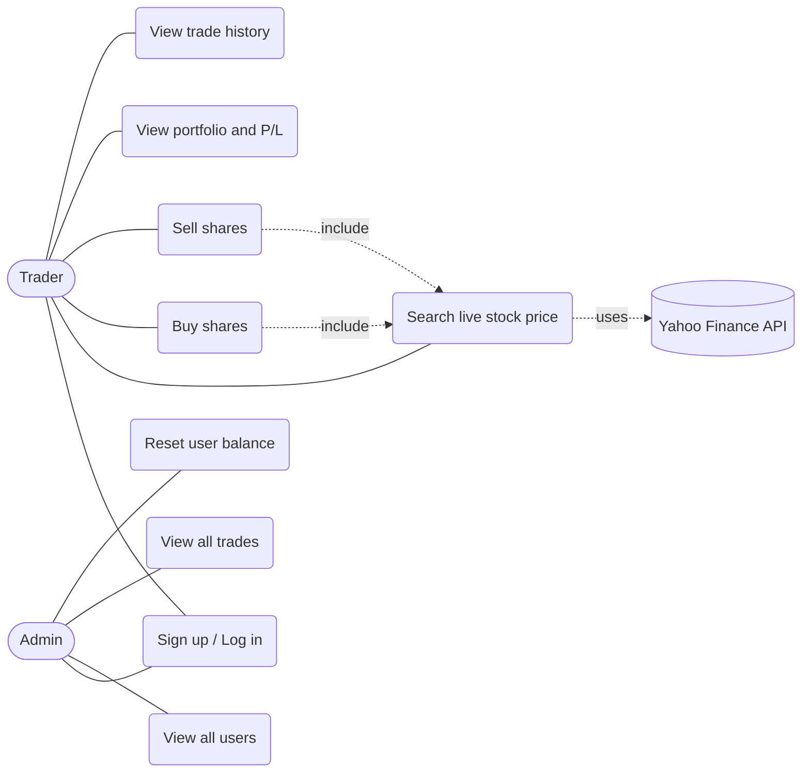
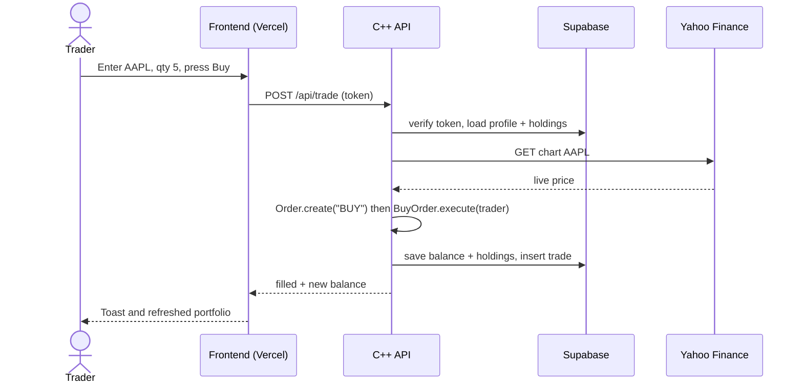
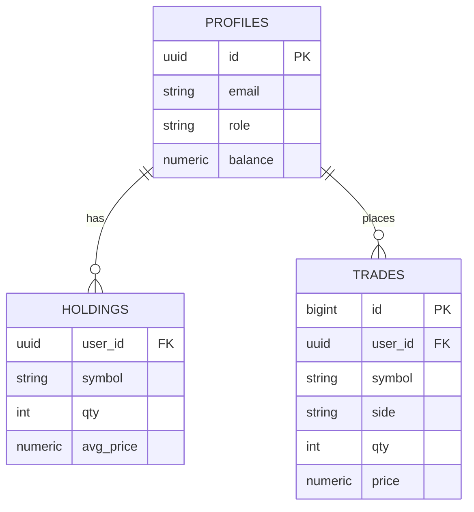
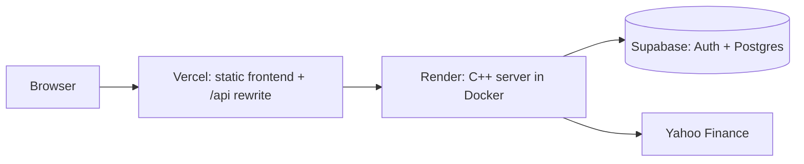

# Stockify – UML diagrams

Open this file in GitHub, VS Code (Markdown Preview Mermaid Support) or paste each block into https://mermaid.live to export PNG/SVG.
The class diagram is in `class-diagram.mmd`.

## Use case diagram

## Sequence diagram – buying a stock

## ER diagram

## Deployment diagram

