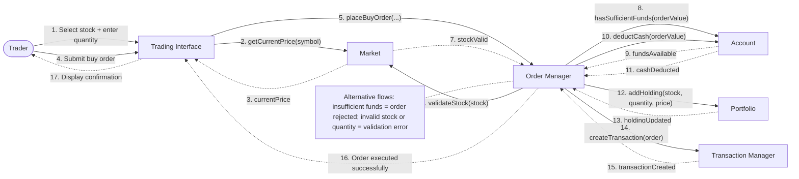
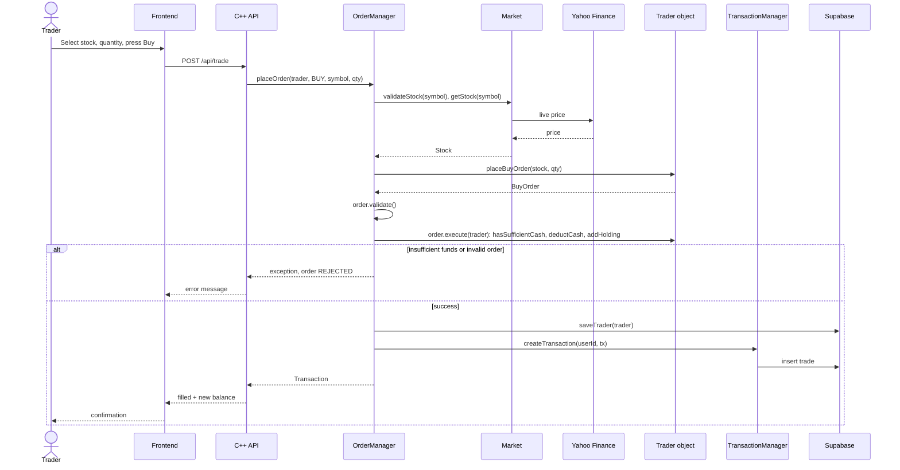
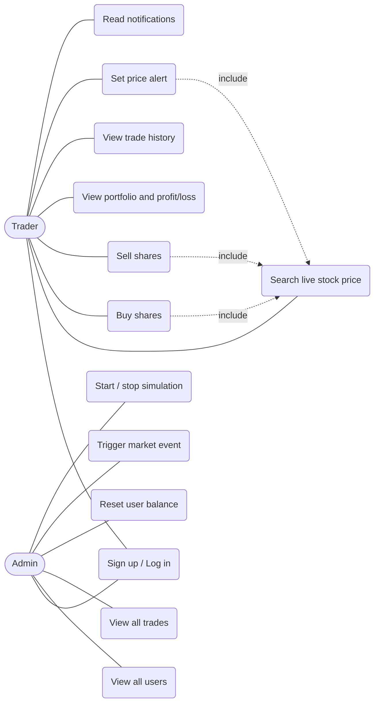
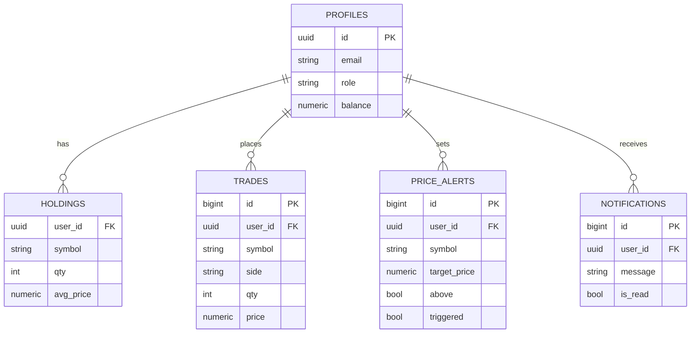
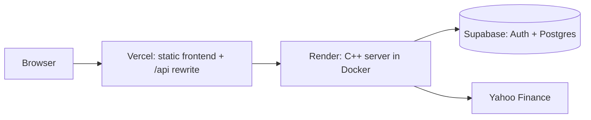

# Stockify – UML diagrams

Open this file in GitHub or VS Code (Mermaid preview), or paste each block into https://mermaid.live to export PNG/SVG.
Class diagram: `class-diagram.mmd`. Object diagram: `object-diagram.mmd`.

## Collaboration (communication) diagram: buying a stock
Same 17 numbered messages as your diagram. The numbers show the order of the calls.

## Sequence diagram (same flow, with the real classes)

## Use case diagram

## ER diagram

## Deployment diagram

